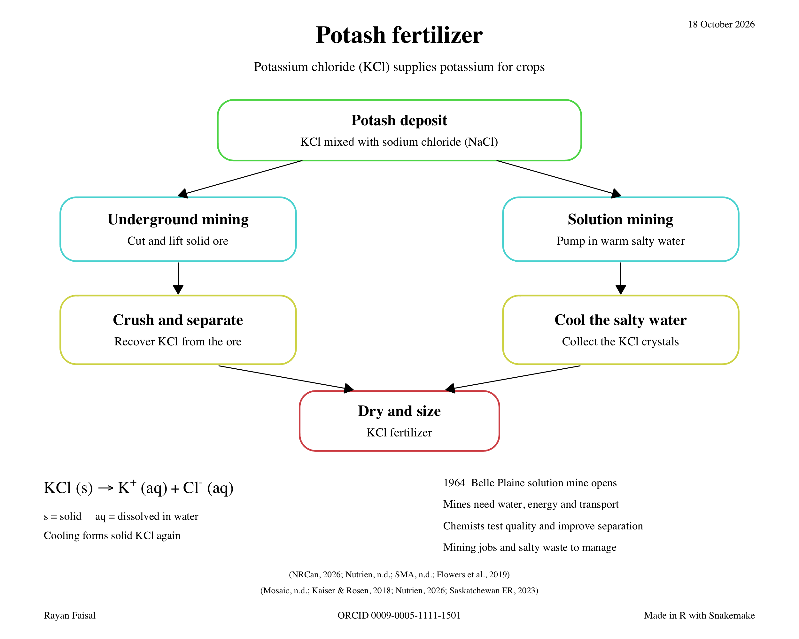

# Potash Fertilizer

*From Underground Salts to Crop Nutrients*

Rayan Faisal  
SCH3U  
[ORCID 0009-0005-1111-1501](https://orcid.org/0009-0005-1111-1501)

The project explains potassium chloride fertilizer, underground mining, solution mining and the chemistry of dissolving and crystallizing KCl.

## Project files

- [Infographic](Potash_Infographic.pdf)
- [Explanation, acknowledgements and APA 7 references](Potash_Explanation.pdf)
- [R code as a one-page PDF](Potash_Infographic_R_Code.pdf)
- [Rights and licensing notice](Potash_Rights_and_Licensing.pdf)
- [Complete original RStudio project](Potash_Fertilizer_Complete.zip)



The explanation contains 406 words. Nine research sources are listed in `references.tsv` and the written PDF. Software and contributor credits are in `Production_credits.txt` and the acknowledgements page.

Document dates are October 18, 2026 for the infographic and explanation, October 19 for acknowledgements and references, and October 20 for the code and licensing notice.

## Build

The infographic is drawn entirely in R using grid. Snakemake runs the builds and input checks. Python and ReportLab typeset the written PDFs.

Open `run.R` in RStudio and click Source, or run:

```sh
snakemake --cores 1
```

Requirements: R with grid, Snakemake, Python 3 and ReportLab. The current PNG export uses the macOS Quartz device. The optional R packages png and rstudioapi provide preview and source navigation in RStudio.

The root copy uses `orcid.png` beside the build scripts. The original downloadable ZIP keeps its `assets/orcid.png` layout. Both contain the same finished PDFs and infographic R source.

## License

Copyright © 2026 Rayan Faisal.

The original written content and infographic are licensed under [Creative Commons Attribution 4.0 International](https://creativecommons.org/licenses/by/4.0/). See [LICENSE.md](LICENSE.md) and the rights notice.

The content license does not relicense software, the ORCID logo or referenced third-party materials. Their applicable rights and licenses remain in effect.
